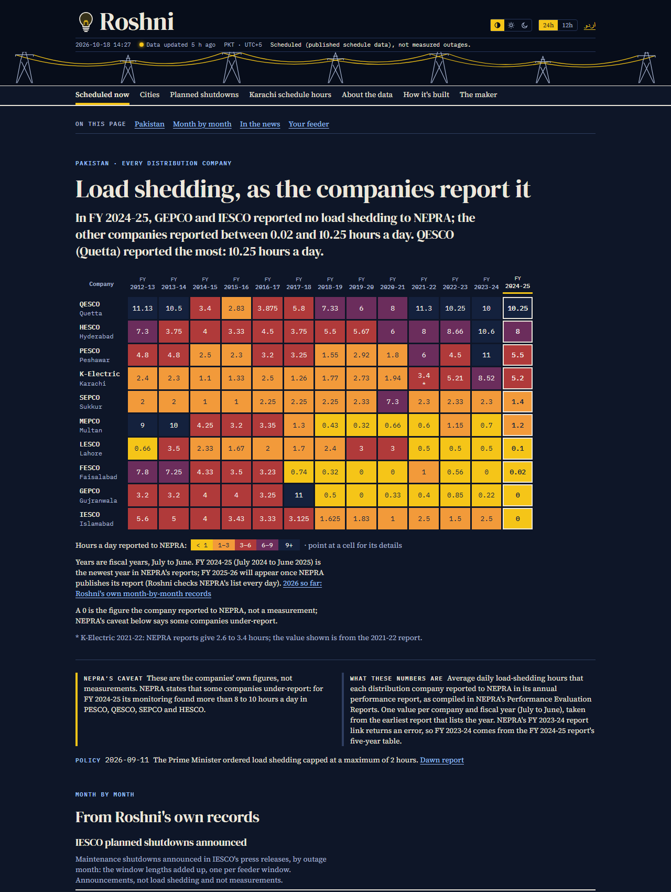
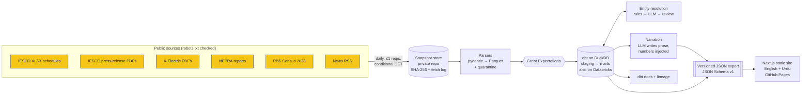
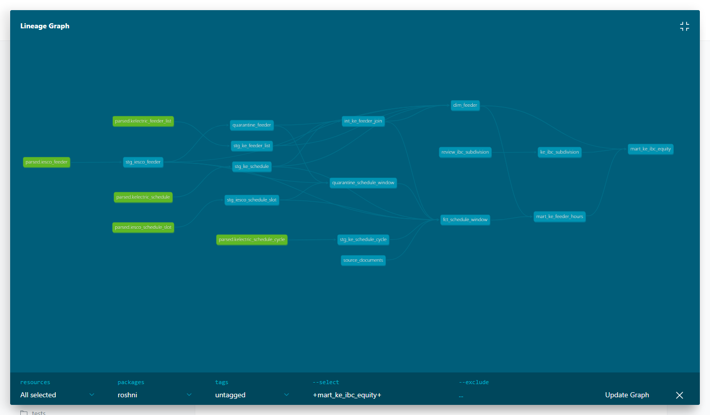
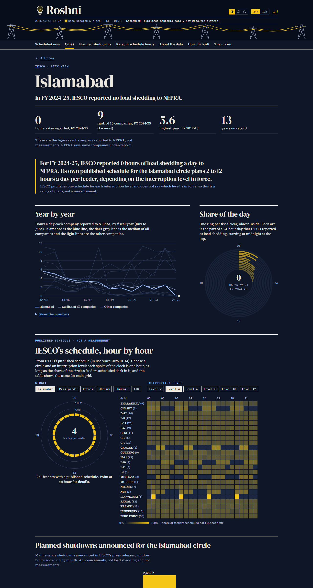
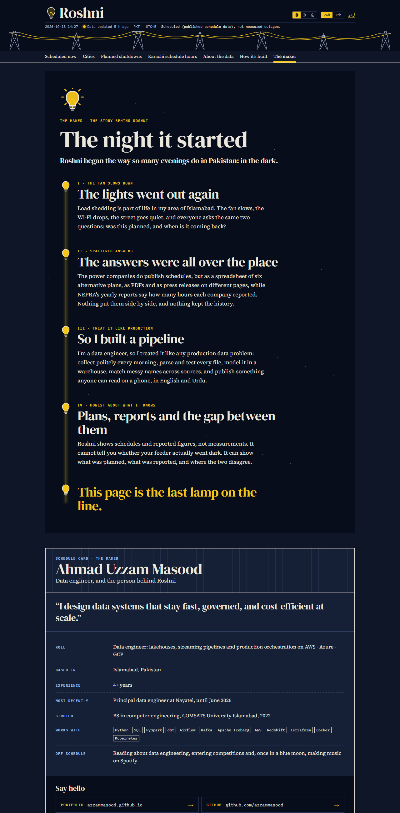
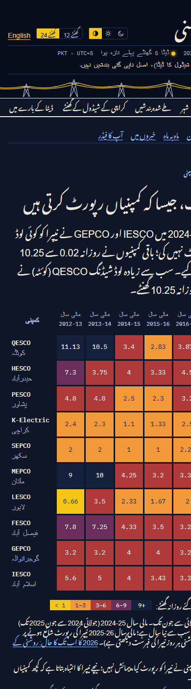

# Roshni · روشنی

**A production data pipeline for Pakistan's load-shedding schedules, rebuilt every morning and published as a bilingual website.**

[**Live site →**](https://azzammasood.github.io/roshni-site/) · [dbt docs and lineage graph](https://azzammasood.github.io/roshni-site/dbt-docs/) · [How it's built](https://azzammasood.github.io/roshni-site/en/architecture/) · [The story behind it](https://azzammasood.github.io/roshni-site/en/maker/) · [Case study](docs/case-study.md)



> *Roshni* means "light". When the power goes out in Pakistan, two questions follow: **was this planned, and when is it coming back?** The answers exist, but they are scattered across spreadsheets, PDFs and press releases on different websites, and nobody keeps the history. Roshni collects them politely every day, tests them, models them in a warehouse and publishes one place to read them, in English and Urdu.

> **Schedules are not measurements.** Roshni shows what the utilities *published* and what the companies *reported to the regulator*, never a claim about what actually happened on a feeder. Not affiliated with IESCO, K-Electric, NEPRA, PBS or any government body.

## At a glance

| | |
|---|---|
| **Runs** | Daily on GitHub Actions (05:30 Pakistan time), plus a news run every 3 hours. A failure opens an issue and the site keeps its last good version. |
| **Sources** | IESCO schedules (6 circles, 6 interruption levels) and press releases · K-Electric feeder list and schedule · NEPRA performance reports (13 fiscal years) · PBS Census 2023 · 14 news feeds |
| **Warehouse** | dbt on DuckDB: 35 models, 117 tests, 15 sources, 5 seeds, one incremental model. The same models run on Databricks. |
| **Quality** | 225 Python tests, Great Expectations suites on every parsed table, quarantine with reasons for unreadable rows, 184 web tests, accessibility (axe) checks, and a check that traces every number on the Karachi page back to the export |
| **Serves** | 1,719 feeders with a published schedule (1,101 IESCO, 618 K-Electric) · 130 company-years of NEPRA figures · 2,675 planned-shutdown windows · about 3,500 static pages in English and Urdu |
| **Costs** | Free-tier hosting and CI. The language-model step is capped at $0.01 per run. |

## Architecture



| Stage | What happens | Tools |
|---|---|---|
| **1 · Snapshot** | Discover files on the publishers' listing pages and fetch politely: robots.txt, at most one request a second, `If-Modified-Since`/`ETag`. Each new version is stored once with its SHA-256 and fetch time. | Python, httpx, Beautiful Soup, GitHub Actions |
| **2 · Parse** | One parser per source turns PDFs and spreadsheets into typed rows. Unreadable rows go to quarantine with a reason; nothing is silently fixed. | poppler `pdftotext` (Docker), openpyxl, pydantic, Parquet |
| **3 · Validate** | Expectation suites on every parsed table; golden-count regression tests on real files. | Great Expectations, pytest |
| **4 · Warehouse** | Staging views → intermediate joins → marts and `quarantine_*` tables, with tests on every model. The SQL stays portable. | dbt, DuckDB, Databricks |
| **5 · Resolve** | Feeder names are matched across sources: exact matches auto-accept, then written rules, then a language model choosing *only among listed candidates*, then review. Every decision stores its confidence and reason, and a backtest keeps the rules honest. | RapidFuzz, OpenRouter, Claude |
| **6 · Analyse and narrate** | Descriptive statistics (no causal claims, sample sizes always shown); a weekly summary in which the model writes prose only and every number is injected and validated. | SQL, OpenRouter |
| **7 · Export** | Versioned JSON validated against JSON Schemas generated from pydantic models. | pydantic, JSON Schema |
| **8 · Publish** | A static Next.js site (TypeScript, Tailwind CSS) with a browser-side "dark now" engine that is checked row for row against the Python version. | Next.js, React, Vitest, axe-core |



## What you can see on the site

| | |
|---|---|
|  | **Cities.** For each company, what it reported to NEPRA year by year, how that compares with the others, and, for Islamabad and Karachi, its own published schedule as a 24-hour clock with a grid-by-hour matrix. Islamabad's page sets IESCO's reported **0 hours** for FY 2024-25 beside its schedule, which plans **2 to 12 hours a day** depending on the interruption level in force. |
|  | **Scheduled now.** Pick a time and an IESCO level, or pin your feeder. **Planned shutdowns** from IESCO's press releases. **Karachi schedule hours by IBC**, descriptive fairness statistics. **How it's built** and **The maker**: the architecture, and the story behind the project. |
|  | **Urdu, right to left**, in Nastaliq, on every page. Accessibility is checked with axe at 375 px in light and dark themes, and every chart has a table view. |

## Engineering decisions worth a look

- **Raw first, never edited.** Every source file is kept exactly as published, keyed by its hash, so any number can be rebuilt from the original document. The snapshot store lives in a separate private repository because the files are third-party documents.
- **Quarantine, not silent fixes.** A row that cannot be parsed is set aside with its reason, and known anomalies are flagged rather than corrected. dbt has `quarantine_*` tables for rows that fail joins.
- **An LLM where it helps, never as the source of truth.** It picks only among listed candidates when matching names, and it writes prose only in the weekly summary. Every number comes from SQL and is validated before publishing, and spend is capped per run.
- **Portable SQL.** The same dbt project builds on DuckDB every day and on Databricks (smoke-tested), with no dialect-specific functions in models.
- **Incremental where it is true.** `fct_planned_shutdown` loads only new press-release files (they never change once published), with a per-adapter strategy: `delete+insert` on DuckDB, `merge` on Databricks.
- **Two schedulers, one CLI.** GitHub Actions runs production. An Airflow DAG in Docker runs the same `roshni` commands as a showcase. Neither contains business logic.
- **Trust signals on the page.** Every page is labelled "schedule, not measurement", the header shows how fresh the data is, every chart has a table view, and every number on the equity page is traced back to the export in CI.

All decisions, with dates and reasons, are in [`docs/DECISIONS.md`](docs/DECISIONS.md); the source inventory and verification oracles are in [`docs/data-audit.md`](docs/data-audit.md).

## How this scales

Roshni's data is small: thousands of rows a day, a few hundred megabytes of documents a year. It runs comfortably on free tiers. The same design carries to a national, near-real-time version:

| Pressure | Today | At scale |
|---|---|---|
| **Volume** (every distribution company, every feeder, full history) | Parquet files, one DuckDB file rebuilt daily | Object storage (S3/ADLS) with **Apache Iceberg** tables partitioned by `source` and `fetched_date`; dbt incremental models with `merge` on Databricks, Snowflake or Athena; full rebuilds only on schema change |
| **Freshness** (outage feeds, smart meters) | Daily batch; news every 3 hours | Events through **Kafka/Kinesis** into a streaming bronze layer; dbt or Spark Structured Streaming micro-batches for "dark now"; the batch marts unchanged |
| **Parsing** (hundreds of PDFs a day) | Sequential, with a PDF-text cache keyed by SHA-256 | The same parsers fanned out per file (AWS Batch, Lambda or Spark), idempotent because outputs are keyed by input hash |
| **Orchestration** | GitHub Actions; Airflow showcase | Airflow (MWAA) or Dagster with sensors on new snapshots, per-source backfills, and SLAs on freshness |
| **Quality** | Great Expectations and dbt tests that fail the run | The same suites as data contracts at the bronze-to-silver boundary; anomaly alerts on row counts and freshness; quarantine tables surfaced in a dashboard |
| **Serving** | Static JSON on GitHub Pages | The same versioned JSON on a CDN for public pages, plus a small API (or DuckDB-Wasm over Parquet) for ad-hoc queries |
| **Cost** | About $0 a month, plus at most $0.01 per LLM run | Storage-heavy and compute-light: incremental models and partition pruning keep warehouse spend proportional to new data, not to history |
| **Governance** | Decisions log, provenance on every row | Column-level lineage from dbt into a catalog (Unity Catalog or DataHub), row provenance kept as today, and PII-free by design (no consumer data ever) |

## Run it yourself

```bash
uv sync                                  # Python 3.12 environment
uv run pytest                            # 225 tests (full-file tests skip without data-sources/)
uv run roshni --help                     # every pipeline step is one command
uv run roshni build                      # dbt build on DuckDB
uv run roshni dbt-docs                   # data/dbt-docs/index.html (lineage graph included)
cd web && npm ci && npm run sync-data:fixtures && npm run dev   # the site, on fixture data
docker compose -f airflow/docker-compose.yml up --build         # Airflow showcase on :8080
```

The full command list is in [`CLAUDE.md`](CLAUDE.md) (the working notes used while building this with Claude Code).

## Operations

- **Daily:** `snapshot.yml` fetches into the private snapshot store, then `publish.yml` parses, validates, builds, resolves, reports, exports, builds the site and the dbt docs, and pushes the site to [`azzammasood/roshni-site`](https://github.com/azzammasood/roshni-site).
- **Secrets:** `SNAPSHOTS_DEPLOY_KEY` (write access to the snapshot store), `SITE_DEPLOY_KEY` (push to the site repo), `OPENROUTER_API_KEY` (optional; without it the narrator falls back to a template).
- **Failure handling:** a failed run opens or updates a `pipeline-failure` issue and closes it after the next good run.

## About

Built by **Ahmad Uzzam Masood**, a data engineer in Islamabad: [portfolio](https://azzammasood.github.io/) · [GitHub](https://github.com/azzammasood) · [LinkedIn](https://www.linkedin.com/in/azzammasood/).

Source documents belong to their publishers (IESCO, K-Electric, NEPRA, PBS and the news outlets). The code is under the [MIT License](LICENSE).
