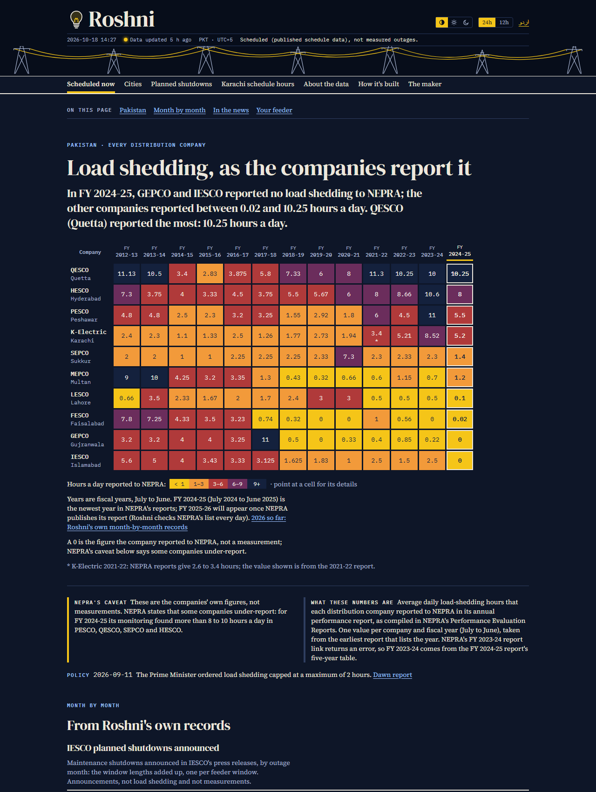
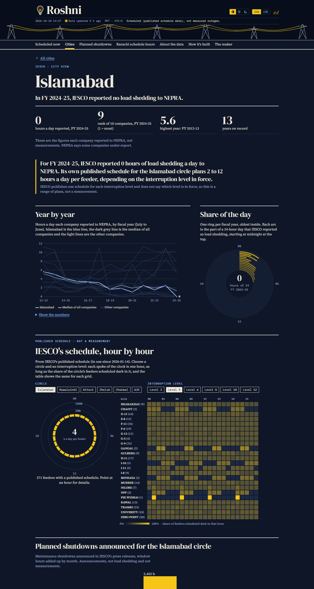
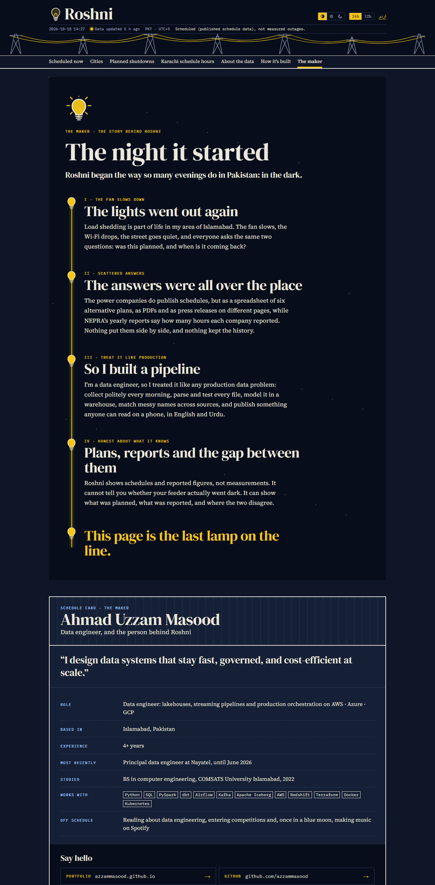
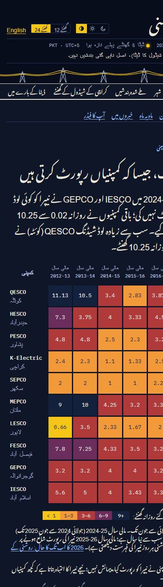

# Roshni · روشنی

**A production data pipeline for Pakistan's load-shedding schedules, rebuilt every morning and published as a bilingual website.**

[](https://github.com/azzammasood/roshni-pipeline/actions/workflows/ci.yml)
[](https://github.com/azzammasood/roshni-pipeline/actions/workflows/publish.yml)
[](https://github.com/azzammasood/roshni-pipeline/actions/workflows/watchdog.yml)
[](LICENSE)

[**Live site →**](https://azzammasood.github.io/roshni-site/) · [**Ask Roshni**](https://azzammasood.github.io/roshni-site/en/ask/) · [Pipeline health](https://azzammasood.github.io/roshni-site/en/health/) · [dbt docs and lineage](https://azzammasood.github.io/roshni-site/dbt-docs/) · [Architecture](https://azzammasood.github.io/roshni-site/en/architecture/) · [Case study](docs/case-study.md) · [Author](https://azzammasood.github.io/roshni-site/en/maker/)

## Architecture

```mermaid
flowchart LR
  subgraph Sources["Public sources (robots.txt checked)"]
    A1[IESCO XLSX schedules]:::src
    A2[IESCO press-release PDFs]:::src
    A3[K-Electric PDFs]:::src
    A4[NEPRA reports]:::src
    A5[PBS Census 2023]:::src
    A6[News RSS]:::src
  end
  S[(Snapshot store<br/>private repo<br/>SHA-256 + fetch log)]
  P[Parsers<br/>pydantic → Parquet<br/>+ quarantine]
  Q{{Great Expectations}}
  W[(dbt on DuckDB<br/>staging → marts<br/>also on Databricks)]
  R[Entity resolution<br/>rules → LLM → review]
  N[Narration<br/>LLM writes prose,<br/>numbers injected]
  E[[Versioned JSON export<br/>JSON Schema v1]]
  Site[Next.js static site<br/>English + Urdu<br/>GitHub Pages]
  Docs[dbt docs + lineage]
  H[Pipeline health page]
  HL[Parser healing<br/>LLM maps new headers,<br/>no-regression gate]
  AR[Ask Roshni on the site<br/>Cloudflare Worker plans,<br/>browser runs the SQL]
  Sources -->|daily, ≤1 req/s,<br/>conditional GET| S --> P --> Q --> W
  W <--> R
  W --> N --> E
  W --> E --> Site
  W --> Docs
  E --> H
  S --> HL -.->|learned aliases| P
  E -->|Parquet| AR --> Site
  classDef src fill:#f5c518,color:#14213d,stroke:#14213d
```



<details>
<summary><b>What each stage does, and with which tools</b></summary>

| Stage | What happens | Tools |
|---|---|---|
| **1 · Snapshot** | Discover files on the publishers' listing pages and fetch politely: robots.txt, at most one request a second, `If-Modified-Since`/`ETag`. Each new version is stored once with its SHA-256 and fetch time. | Python, httpx, Beautiful Soup, GitHub Actions |
| **2 · Parse** | One parser per source turns PDFs and spreadsheets into typed rows. Unreadable rows go to quarantine with a reason; nothing is silently fixed. When a maintenance workbook arrives with headers the parser has never seen, a language model maps them to known fields and the mapping is kept only if every stored workbook still parses exactly as before. | poppler `pdftotext` (Docker), openpyxl, pydantic, Parquet, Groq |
| **3 · Validate** | Expectation suites on every parsed table; golden-count regression tests on real files. | Great Expectations, pytest |
| **4 · Warehouse** | Staging views → intermediate joins → marts and `quarantine_*` tables, with tests on every model. The SQL stays portable. | dbt, DuckDB, Databricks |
| **5 · Resolve** | Feeder names are matched across sources: exact matches auto-accept, then written rules, then a language model choosing *only among listed candidates*. Every decision stores its confidence and reason, and a backtest keeps the rules honest. | RapidFuzz, OpenRouter, Claude |
| **6 · Analyse and narrate** | Descriptive statistics (no causal claims, sample sizes always shown); a weekly summary in which the model writes prose only and every number is injected and validated. | SQL, OpenRouter |
| **7 · Export** | Versioned JSON validated against JSON Schemas generated from pydantic models, including the pipeline's own health records. | pydantic, JSON Schema |
| **Ask** | [Ask Roshni](https://azzammasood.github.io/roshni-site/en/ask/) answers plain-language questions on the site (and `roshni ask` on the command line). A Cloudflare Worker holds the key and the prompts and plans one SQL query; the visitor's browser checks it with DuckDB's own parser and runs it on the published Parquet, so every number comes from that query; the Worker checks the narration. | Cloudflare Workers + Durable Objects, DuckDB-WASM, sqlglot, Groq |
| **8 · Publish** | A static Next.js site (TypeScript, Tailwind CSS) with a browser-side "dark now" engine that is checked row for row against the Python version. | Next.js, React, Vitest, axe-core |

</details>

## Why

*Roshni* means "light". When the power goes out in Pakistan, two questions follow: **was this planned, and when is it coming back?** The answers exist, but they are scattered across spreadsheets, PDFs and press releases on three publishers' websites, files are replaced without notice, and nobody keeps the history. Roshni collects them every day, tests them, models them in a warehouse and publishes one place to read them, in English and Urdu.

> **Schedules are not measurements.** Roshni shows what the utilities *published* and what the companies *reported to the regulator*, never a claim about what actually happened on a feeder. Not affiliated with IESCO, K-Electric, NEPRA, PBS or any government body.

## Impact and scale

Figures as of 2026-11-24, from the pipeline's own records; the [pipeline health page](https://azzammasood.github.io/roshni-site/en/health/) shows them live.

| | |
|---|---|
| **Manual work replaced** | Checking the IESCO, K-Electric and NEPRA websites by hand (15 IESCO workbooks, daily press releases, two K-Electric PDFs, NEPRA's annual reports) and 14 news feeds. Since 2026-11-08 the pipeline runs with **no manual step**: new schedule versions are dated from the file itself and new listing rows are picked up automatically, with a notice instead of a stop. |
| **Runs** | A publish run every day, news every 3 hours, a freshness watchdog every 3 hours. **The last 14 publish runs all succeeded**; a successful run takes a median **4 min 20 s**. Of 77 runs recorded since 2026-10-12, 55 succeeded: the failures are a 17-day stall in October, written up in [ADR 0006](docs/adr/0006-automate-review-gates.md). |
| **Volume** | **3,549** polite fetches over 49 days, **199** new file versions stored. In the warehouse: **48,732** scheduled windows, **20,526** announced maintenance windows, **4,410** planned-shutdown windows, **1,726** feeders with a published schedule (1,101 IESCO, 625 K-Electric) and 130 company-years of NEPRA figures. |
| **Quality** | 346 Python tests, 633 web tests (including a 514-case check that the browser's "dark now" engine matches the Python one), 47 Worker tests, 38 dbt models with 129 tests (all 172 nodes pass in the latest build), Great Expectations on every parsed table, accessibility checks (axe) at phone width in light and dark themes. |
| **Build speed (measured)** | A full warehouse build of today's data (181,660 input rows) takes about **12 s** on a 4-core laptop; synthetic **10×** data (1.8 M rows) builds in about **20 s** and **100×** (18.1 M rows) in **139 s**. Method and every run: [`docs/benchmarks.md`](docs/benchmarks.md). |
| **Output** | About 3,500 static pages in English and Urdu, versioned JSON for every page, and dbt docs with the lineage graph. |
| **Cost** | About $0 a month on free tiers. The weekly report's language-model step is capped at $0.01 a run; Ask Roshni and parser healing run on Groq's free plan with free OpenRouter models as fallback; the Ask Roshni Worker runs on Cloudflare's free plan. |

## AI in the pipeline, measured

Language models do a few narrow jobs here (Ask Roshni, self-healing parsers, a daily one-line summary), each built so the model can be wrong without the data being wrong, each scored on its own evaluation set in production, and each watched. Everything else that looks like AI is plain code on purpose: routing everyday questions, choosing charts, matching places in news headlines.

What sets them apart from a typical text-to-SQL or "LLM fixes my parser" demo:

- **The model never produces a number or a data value.** Ask Roshni's numbers come from a query the visitor's own browser runs; the narrator may only write placeholders. The healer only names columns; parsing stays deterministic.
- **Code decides, not the model.** Ask Roshni's SQL passes a guard on DuckDB's own parse tree before it runs. A learned parser alias is kept only if every stored workbook still parses exactly as before.
- **Measured, then monitored.** Ask Roshni's 104-item golden set (35 questions and 69 paraphrases) is scored in daily slices in the production workflow, so a week covers all of it within one free Groq account; the health page shows the pooled 7-day score with a 95% interval. The parser-healing chaos test runs every Monday. Each run adds a history point to [`evals/`](evals/); an item that passed before and fails now is posted as a pipeline notice; the live [health page](https://azzammasood.github.io/roshni-site/en/health/#ask) also shows usage counts and visitors' votes.
- **Models only where they are needed.** "Will I get load shedding today?" goes to the site's tested schedule engine for the visitor's own feeder, not to a model. Charts are chosen by code from the result's shape. Example answers, the equity page's "Explain this" links and the busy fallback are prepared once each morning by the same pipeline.

**Ask Roshni** ([`docs/ask-roshni.md`](docs/ask-roshni.md)): `roshni ask "Which IBC areas have the highest share of twelve-hour feeders?"`

- A prompt-injection screen (`llama-prompt-guard-2`) runs before anything else.
- The planner sees a **semantic layer**: allowlisted tables and columns, described by the dbt docs, with real category values. It refuses questions about actual outages, causes, forecasts, consumers or income.
- A **SQL guard** (sqlglot) allows one read-only SELECT on allowlisted columns only. Queries run on a read-only connection with external access off, a row cap and a timeout, with one self-correcting retry.
- The narrator writes **placeholders, never numbers**. A validator rejects digits, causal wording and "actual outage" wording. Caveats, `n` and the build time are added by code.

**On the site** ([try it](https://azzammasood.github.io/roshni-site/en/ask/), English and Urdu; on the Urdu page the answer is written in Urdu and checked by an Urdu version of the narration rules). The site is static, so the work is split:

- A **Cloudflare Worker** holds the Groq key and the prompts (fetched from the site, never taken from the browser), runs the guard and the planner, and checks the narration.
- The **visitor's browser** runs the SQL with DuckDB-WASM on about 400 KB of published Parquet, after checking it against the allowlist with DuckDB's own parse tree. External access is switched off first, and the engine and its extensions are served by the site itself.
- **Caps** keep one visitor from using up the free limits: 3 questions a minute and 10 a day per visitor (an HMAC of the IP and the day, never the IP itself), and 150 questions and 450K tokens a day for the whole site, sized from the eval's token use and Groq's free-plan limits.
- **Parity tests** pin the TypeScript ports to Python: 25 narration checks, 48 SQL-guard verdicts, and every golden reference query returning the same rows in the browser as in the warehouse.
- **Follow-ups** are planned with the visitor's earlier question and plan, held by the Worker for 10 minutes (the browser never supplies model context). Every answer has a step-by-step trace (injection score, each model call with tokens and time, the browser's guard verdict, DuckDB time) and a vote (counts only).
- **Usage counts, not logs.** The Worker counts per day: questions, visitors, refusals, injection blocks, queries corrected after the browser's check, cap refusals, tokens and planning-time buckets. It stores no question text and no visitor id; the health page reads the counts live.

**Roshni over MCP** ([`docs/mcp.md`](docs/mcp.md)): `roshni mcp` serves the same tables to any MCP client (Claude Desktop, IDEs, agents) behind the same SQL guard and caveats. The client brings its own model, so it costs no tokens.

**Self-healing parsers** ([`docs/parser-healing.md`](docs/parser-healing.md)): `roshni heal`, run before parsing every day. Narrow on purpose: it heals one kind of failure, column headings in IESCO's monthly maintenance workbooks, because that is the drift the sources actually show and the one a regression gate can check exactly. New date formats or file types still go to quarantine with a reason.

- Drift means a workbook with no recognised header, or one that quarantines more than 25 % of its rows.
- The model maps columns to the parser's known fields. It never outputs a data value.
- A **deterministic gate** keeps the mapping only if the broken file parses again and every other stored workbook parses exactly as before.
- Accepted mappings become reviewable header aliases, recording who decided and the evidence. Rows read through one are flagged.

| Evaluation (Groq free plan, first full runs) | qwen3.8-27b | gpt-oss-120b | gpt-oss-20b |
|---|---|---|---|
| Ask Roshni: 25-item golden set, scored by execution match (19 answers, 4 refusals, 2 injections), 2026-11-24 | **25/25**, 0.94 s mean | **25/25**, 1.89 s | 24/25, 1.20 s |
| Parser healing: 27 chaos cases (9 real workbooks with headers renamed in English, abbreviated or in Urdu), exact row-for-row recovery, 2026-11-25 | 23/27 (4 × HTTP 429) | 26/27 | **27/27** |

Since 2026-11-26 the golden set has 35 items: 22 answers (including one asked in Urdu, a paraphrase, and a real question with an injection attached), 8 refusals (measured outages, income, other companies, a named person), 2 injections that must be blocked, and 3 rule-breaking attempts that must not be answered (role-play, an Urdu injection, a file read). Since 2026-11-27 each question also has paraphrases (104 items in all), scored a seventh a day; the health page shows the 7-day score with two 95% intervals, per item and grouped by question (paraphrases of one question pass or fail together, so the grouped one is the honest one). Backup models are scored on Sundays in turn. Visitors can share a question with a down vote (opt-in); shared questions become reviewed candidates in [`evals/candidates.yml`](evals/), never test items automatically. The latest scores and their history are on the [health page](https://azzammasood.github.io/roshni-site/en/health/#ask).

Both evaluation write-ups list the bugs their first runs found in the evaluation and in the product, and how each was fixed. Providers are an OpenAI-compatible chain ([`config/llm.yml`](config/llm.yml)): Groq first, OpenRouter's free models as fallback, with every attempt's tokens and latency recorded.

## Key trade-offs

Each is a one-page record with the options I considered and what the choice costs:

1. [DuckDB, with dbt SQL kept portable to Databricks](docs/adr/0001-duckdb-with-portable-dbt-sql.md)
2. [Static versioned JSON on GitHub Pages instead of an API](docs/adr/0002-static-versioned-json-on-github-pages.md)
3. [Raw snapshots in a private git repo](docs/adr/0003-raw-snapshots-in-a-private-git-repo.md)
4. [Great Expectations on Parquet, dbt tests on models](docs/adr/0004-great-expectations-on-parquet-dbt-tests-on-models.md)
5. [Entity resolution: rules first, then an LLM limited to listed candidates](docs/adr/0005-entity-resolution-rules-then-constrained-llm.md)
6. [Automating the review gates](docs/adr/0006-automate-review-gates.md)
7. [Publishing after a failed snapshot, plus a watchdog](docs/adr/0007-publish-after-failed-snapshot-and-watchdog.md)

Where the obvious approach failed and what the code does instead, each backed by a test: [`docs/hard-problems.md`](docs/hard-problems.md). Every decision, with its date and reason: [`docs/DECISIONS.md`](docs/DECISIONS.md).

## What you can see on the site



| | |
|---|---|
|  | **Cities.** For each company, what it reported to NEPRA year by year, how that compares with the others, and, for Islamabad and Karachi, its own published schedule as a 24-hour clock with a grid-by-hour matrix. Islamabad's page sets IESCO's reported **0 hours** for FY 2024-25 beside its schedule, which plans **2 to 12 hours a day** depending on the interruption level in force. |
|  | **Scheduled now.** Pick a time and an IESCO level, or pin your feeder. **Planned shutdowns** from IESCO's press releases. **Karachi schedule hours by IBC**, descriptive fairness statistics. **Architecture** and **Author**: the architecture, and the story behind the project. |
|  | **Urdu, right to left**, in Nastaliq, on every page. Accessibility is checked with axe at 375 px in light and dark themes, and every chart has a table view. |

## Engineering decisions worth a look

- **Raw first, never edited.** Every source file is kept exactly as published, keyed by its hash, so any number can be rebuilt from the original document. The snapshot store lives in a separate private repository because the files are third-party documents.
- **Quarantine, not silent fixes.** A row that cannot be parsed is set aside with its reason, and known anomalies are flagged rather than corrected. dbt has `quarantine_*` tables for rows that fail joins.
- **An LLM where it helps, never as the source of truth.** It picks only among listed candidates when matching names, writes prose only in the weekly summary and in Ask Roshni, writes SQL only inside an allowlist, and names columns only when healing a parser. Every number comes from SQL and is validated before publishing, every model output passes a deterministic check, and spend is capped per run.
- **Portable SQL.** The same dbt project builds on DuckDB every day and on Databricks (smoke-tested), with no dialect-specific functions in models.
- **Incremental where it is true.** `fct_planned_shutdown` loads only new press-release files (they never change once published), with a per-adapter strategy: `delete+insert` on DuckDB, `merge` on Databricks.
- **Questions answered without a query server.** Ask Roshni's SQL runs in the visitor's browser on published Parquet; the only server-side piece is a small capped Worker that holds the key. The same split carries to larger data: precomputed Parquet on a CDN, compute at the edge or in the browser.
- **Two schedulers, one CLI.** GitHub Actions runs production. An Airflow DAG in Docker runs the same `roshni` commands as a showcase. Neither contains business logic.
- **Trust signals on the page.** Every page is labelled "schedule, not measurement", the header shows how fresh the data is, every chart has a table view, and every number on the equity page is traced back to the export in CI.

The source inventory and verification oracles are in [`docs/data-audit.md`](docs/data-audit.md).

## How this scales

Roshni's data is small: thousands of rows a day, a few hundred megabytes of documents a year. It runs comfortably on free tiers. I measured how far the current design goes before changing anything ([`docs/benchmarks.md`](docs/benchmarks.md), one 4-core laptop, three runs each):

- **Today's data:** a full build (181,660 input rows, 38 models, 129 tests) takes about 12 s, of which dbt is about 5 s; peak memory about 330 MiB.
- **Incremental:** loading one new press release into `fct_planned_shutdown` takes 0.16 s of model time.
- **10× and 100× synthetic data:** 1.8 M rows build in about 20 s; 18.1 M rows in 139 s with about 4 GB peak memory and a 1 GB DuckDB file.
- **What it found:** one census join was quadratic. At 100× it took 1,710 of 1,748 seconds. Rewriting it to join on an equality key brought the 100× build down to 139 s, with identical output.

So a single DuckDB file comfortably holds about 100 times today's volume. Beyond that, the same design carries to a national, near-real-time version:

| Pressure | Today | At scale |
|---|---|---|
| **Volume** (every distribution company, every feeder, full history) | Parquet files, one DuckDB file rebuilt daily | Object storage (S3/ADLS) with **Apache Iceberg** tables partitioned by `source` and `fetched_date`; dbt incremental models with `merge` on Databricks, Snowflake or Athena; full rebuilds only on schema change |
| **Freshness** (outage feeds, smart meters) | Daily batch; news every 3 hours | Events through **Kafka/Kinesis** into a streaming bronze layer; dbt or Spark Structured Streaming micro-batches for "dark now"; the batch marts unchanged |
| **Parsing** (hundreds of PDFs a day) | Sequential, with a PDF-text cache keyed by SHA-256 | The same parsers fanned out per file (AWS Batch, Lambda or Spark), idempotent because outputs are keyed by input hash |
| **Orchestration** | GitHub Actions; Airflow showcase | Airflow (MWAA) or Dagster with sensors on new snapshots, per-source backfills, and SLAs on freshness |
| **Quality** | Great Expectations and dbt tests that fail the run | The same suites as data contracts at the bronze-to-silver boundary; anomaly alerts on row counts and freshness; quarantine tables surfaced in a dashboard |
| **Serving** | Static JSON on GitHub Pages; ad-hoc questions run in the browser (DuckDB-WASM over Parquet) behind a capped Worker | The same versioned JSON and Parquet on a CDN; a paid model tier and higher Worker caps for ad-hoc questions, or a small query API if the data outgrows the browser |
| **Cost** | About $0 a month, plus at most $0.01 per LLM run | Storage-heavy and compute-light: incremental models and partition pruning keep warehouse spend proportional to new data, not to history |
| **Governance** | Decisions log, provenance on every row | Column-level lineage from dbt into a catalog (Unity Catalog or DataHub), row provenance kept as today, and PII-free by design (no consumer data ever) |

## Run it yourself

```bash
uv sync                                  # Python 3.12 environment
uv run pytest                            # 346 tests (full-file tests skip without data-sources/)
uv run roshni --help                     # every pipeline step is one command
uv run roshni build                      # dbt build on DuckDB
uv run roshni dbt-docs                   # data/dbt-docs/index.html (lineage graph included)
uv run roshni ask "How many listed K-Electric feeders have scheduled hours per day?"   # needs GROQ_API_KEY
uv run roshni ask-eval                   # golden-set eval of every model in config/llm.yml
uv run roshni heal-eval --snapshots STORE   # chaos eval of parser healing on stored workbooks
cd web && npm ci && npm run sync-data:fixtures && npm run dev   # the site, on fixture data
docker compose -f airflow/docker-compose.yml up --build         # Airflow showcase on :8080
```

The full command list is in [`CLAUDE.md`](CLAUDE.md) (the working notes used while building this with Claude Code).

## Operations

- **Daily:** `snapshot.yml` fetches into the private snapshot store, then `publish.yml` parses, validates, builds, resolves, reports, exports, builds the site and the dbt docs, and pushes the site to [`azzammasood/roshni-site`](https://github.com/azzammasood/roshni-site).
- **Evals in production:** every `publish.yml` run scores a seventh of Ask Roshni's golden set (`roshni ask-eval --main --daily --record`, one backup model too on Sundays) and on Mondays the parser-healing chaos test (`roshni heal-eval --main --record`), commits the records in `evals/`, and posts a notice when an item that passed before fails, or a 7-day score falls below its floor (90 % and 85 %). The same run prepares the example answers (each checked against its golden reference before it is published) and today's summary. A failed eval never stops the publish.
- **Ask Roshni Worker:** `worker-deploy.yml` typechecks, tests and deploys `worker/` to Cloudflare on every change, copies the Groq key into it, and smoke-tests the live Worker. Publish builds the site with the Worker's address, which switches on the Ask page.
- **Secrets:** `SNAPSHOTS_DEPLOY_KEY` (write access to the snapshot store), `SITE_DEPLOY_KEY` (push to the site repo), `OPENROUTER_API_KEY` (optional; without it the narrator falls back to a template), `GROQ_API_KEY` (parser healing and the Ask Roshni Worker; without it the chain uses OpenRouter), `CLOUDFLARE_API_TOKEN` (Worker deploys).
- **Failure handling:** a failed run opens or updates a `pipeline-failure` issue and closes it after the next good run. Publish still runs after a failed snapshot, using the last good files.
- **Watchdog:** every 3 hours `watchdog.yml` checks that the live site is under 36 hours old, and that Ask Roshni is healthy (failed plans and planning time from the Worker's counts), and opens an issue that notifies me if not; weekly it re-enables the scheduled workflows so GitHub's 60-day inactivity rule never switches them off.
- **Automatic decisions:** new schedule versions, new listing rows and learned parser header aliases are handled without stopping the run and reported in a "Pipeline notices" issue.
- **Infrastructure as code:** [`infra/databricks/`](infra/databricks/) holds Terraform for the optional Databricks deployment (catalog, schemas, volume, SQL warehouse, a paused job), checked in CI with `fmt`, `validate` and tflint. Nothing is applied automatically.

## About

I'm **Ahmad Uzzam Masood**, a data engineer in Islamabad, and I built Roshni: [portfolio](https://azzammasood.github.io/) · [GitHub](https://github.com/azzammasood) · [LinkedIn](https://www.linkedin.com/in/azzammasood/).

Source documents belong to their publishers (IESCO, K-Electric, NEPRA, PBS and the news outlets). The code is under the [MIT License](LICENSE).
