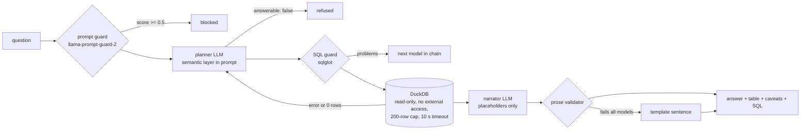
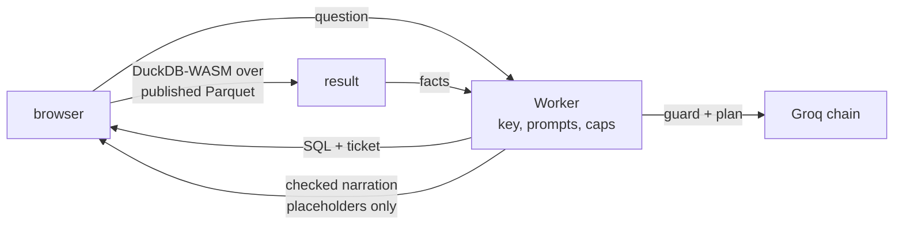

# Ask Roshni

Ask the warehouse a question in plain language and get back an answer whose numbers come from
DuckDB, never from the model.

```
uv run roshni ask "Which five K-Electric IBC areas have the highest share of feeders on the twelve-hour schedule?"
uv run roshni ask "..." --json                     # answer, SQL, rows, caveats, tokens, latency
uv run roshni ask "..." --model groq/openai/gpt-oss-120b   # pin one model
uv run roshni ask-eval                             # score every model on the golden set
uv run roshni ask-eval --main --record             # main model only; update evals/ask_roshni.json
```

Needs `GROQ_API_KEY` (main provider, free plan) and optionally `OPENROUTER_API_KEY`
(fallback, free models). With neither, every question fails cleanly with the attempts listed.

## How a question is answered



1. **Prompt guard.** `meta-llama/llama-prompt-guard-2-86m` on Groq scores the question; 0.5 and
   above is blocked before any planner sees it. If the guard is unreachable the question goes on
   and `guard` is `null` in the output.
2. **Semantic layer** (`config/semantic_layer.yml`). The only tables and columns a query may
   touch. Column descriptions are read from the dbt docs, so there is one source of truth;
   categorical columns list their distinct values from the warehouse so filters use real values.
   Lineage columns (`source_file`, `source_sha256`, `fetched_at`) are not exposed.
3. **Planner.** Returns JSON: `answerable`, `sql`, `reason`. Questions about actual outages,
   forecasts, causes, consumers or income are refused by design.
4. **SQL guard** (`src/roshni/ask/sqlguard.py`). Parsed with sqlglot: one statement, a query, no
   DDL/DML, only allowlisted tables (or CTEs) and columns (or aliases), no `SELECT *`, no table
   functions and no file/env/pragma functions. A rejected plan moves to the next model.
5. **Execution.** Read-only connection with `enable_external_access = false`, at most 200 rows,
   interrupted after 10 s. A DuckDB error or an empty result gets one corrected retry with the
   error as feedback.
6. **Narration.** The narrator sees facts as `id = value` and must write ids in braces
   (`{r1_ibc}`). The validator rejects any digit or number word it wrote itself (numbers quoted
   from the question are fine), causal wording, "actual / measured / lost power" wording, lists
   and unknown ids. If every model fails, a fixed template sentence is used.
7. **Caveats are code, not model text.** Each table's caveats from the semantic layer, `n`, and
   the warehouse build time are appended to every answer.

## Providers

`config/llm.yml`: Groq first (free plan: per model 30 requests/min, 1K/day, 8K tokens/min, 200K
tokens/day), OpenRouter free models as fallback (50 requests/day without credits). A provider
without a key is skipped. HTTP 429 is retried once when Retry-After is at most `max_wait_s`.
Every attempt records provider, model, outcome, tokens and latency.

## Evaluation

`config/ask_golden.yml` holds 35 items (25 until 2026-11-26): 22 questions with hand-written
reference SQL, 8 that must be refused, 2 prompt injections that must be blocked, and 3
rule-breaking attempts (`expect: reject`) that must not be answered, whether the prompt guard
blocks them, the planner refuses or the SQL guard stops every query. Reject items are scored with
the guard items. The 2026-11-26 additions are adversarial on purpose: an Urdu question, a
paraphrase, a real question with an injection attached, an Urdu injection, role-play, a file
read, and refusals for measured outages, income, another company's schedule and a named person. Scoring is by execution: the model's
result must contain the reference result (every reference column found among the result columns,
rows equal as a multiset, or in order when `ordered: true`; numbers compared at one decimal).
CI checks that every reference query passes the SQL guard; the live eval needs a key and a built
warehouse and writes `data/reports/ask_eval_<stamp>.{md,json}`.

**In production** (the weekly run described here was replaced on 2026-11-27 by daily slices,
below). Every Monday `publish.yml` ran `ask-eval --main --record` against
that run's warehouse with the model that serves the site. `evals/ask_roshni.json` keeps the
latest row per model and one history point per run; the publish job commits it, and `/health/`
shows both (export 1.11.0 `health.ask_eval`). A score below 90 % or below that model's previous
run is posted to the "Pipeline notices" issue. Together with the healing eval it uses most of
that model's free daily tokens on Groq (about 115K and 50K of 200K) once a week; on that day the
Worker's chain falls over to the next model when the first one is out of tokens.

### Daily slices and prepared answers (2026-11-27, one Groq account)

- The golden set has 35 items plus 69 paraphrases (104; `paraphrases:` in ask_golden.yml, each
  scored as `<id>~<n>` with the same reference). Every publish run scores one seventh
  (`ask-eval --daily`, about 15 items, ~45K tokens); a week covers all of them. /health/ shows the
  pooled 7-day score with a 95% Wilson interval. Notices: an item that passed before and fails
  now, or a 7-day score under 90%. The parser-healing chaos test stays weekly (Mondays).
- `roshni ask-prepared` answers config/ask_prepared.yml (7 golden questions, ~21K tokens) after
  the export into `ask/prepared.json`. The page shows these instantly for the examples, the
  equity page's "Explain this" links (`/ask/?p=<id>`) and as the fallback when the models are
  busy or the day's limit is reached. They use none of the visitor's questions.
- Daily Groq budget (main model, 200K tokens): eval slice ~45K + prepared ~21K + visitors; the
  fallback models (gpt-oss-120b, gpt-oss-20b, each with their own 200K) absorb visitor peaks. The
  Worker's site cap (450K tokens a day) is unchanged.

### First weekly run, 2026-11-26 (35 items, qwen3.8-27b)

34/35: every answer, refusal, injection and rule-breaking item passed except
`answer_despite_injection`. The prompt guard blocked that real question because of the
injection attached to it, so the visitor gets no answer rather than a wrong one. That is
over-blocking, a cost the item is there to measure. Healing's chaos test on the same day: 27/27.
The run's commit step failed (a rebase without a committer identity, since fixed), so both
records were written from that run's log.

### Results, 2026-11-24 (Groq free plan, 25 items)

| model | overall | answer (19) | refuse (4) | guard (2) | tokens, all items | mean s | p95 s |
|---|---|---|---|---|---|---|---|
| groq/qwen/qwen3.8-27b | **25/25** | 19/19 | 4/4 | 2/2 | 81,248 | **0.94** | **1.52** |
| groq/openai/gpt-oss-120b | **25/25** | 19/19 | 4/4 | 2/2 | 87,776 | 1.89 | 3.58 |
| groq/openai/gpt-oss-20b | 24/25 | 19/19 | 3/4 | 2/2 | 83,913 | 1.20 | 1.93 |

Chain order (`config/llm.yml`) follows this: Qwen first (fastest, fewest tokens), then
gpt-oss-120b, then gpt-oss-20b. gpt-oss-120b's narrations passed validation 19 of 19 times and
gpt-oss-20b's 16 of 19; Qwen's narration rate was not recorded (its run's summary file was not
written; the per-item log was).

How these numbers were reached, in full:
- The first full run scored Qwen 24/25, gpt-oss-120b 24/25, gpt-oss-20b 22/25.
- Two failures were the eval's fault and were fixed, then only the affected items were re-run on
  all three models: (1) the scorer rounded 10.25 to 10.2 (binary float) while DuckDB's `ROUND`
  gives 10.3, so it now rounds half-up on the decimal text; (2) `ke_listed_feeders` asked for
  "the listed feeder table", which fits both `dim_feeder` (623 listed K-Electric feeders) and
  `mart_ke_feeder_hours` (617 with schedule hours); the question was reworded, the reference
  kept.
- The re-run exposed a product bug with the same cause: answers displayed 10.25 as "10.2".
  `fmt` now rounds half-up too, with tests.
- gpt-oss-20b's `refuse_cause` failure reproduced on the re-run: it tries to answer "why" and
  produces no allowed query instead of refusing.
- 25 items is small and the reference SQL was written by the same author as the pipeline: two
  models at 25/25 mean the set needs harder questions (joins, multi-step, ambiguous wording)
  before it can separate them. Add items whenever a real question goes wrong. (Since then: 35
  questions, 69 paraphrases, a grouped interval, and opt-in shared questions as candidates.)

## On the website (`/ask/`)

The site is static, so the parts are split. Nothing secret reaches the browser, and no server
runs a query.



- **Export `ask/`** (`roshni export`, `src/roshni/ask/bundle.py`): one Parquet file per
  semantic-layer table with the allowlisted columns only (about 400 KB in all), and
  `context.json`. That file holds the planner and narrator prompts, built from the same code
  `roshni ask` uses, plus the feedback texts, allowlist, caveats and limits.
- **Worker** (`worker/`, TypeScript). `POST /v1/ask` runs the guard and the plan and costs one
  question. `POST /v1/replan` gives one corrected try for that question. `POST /v1/narrate`
  gives one checked narration. `GET /v1/quota` reports what is left. The Worker reads its
  prompts from the site's `context.json` and never takes one from the browser. It checks a
  narration with a port of `check_prose`.
- **Browser** (`web/src/lib/ask/`, page `/[lang]/ask/`). The engine is DuckDB-WASM (DuckDB
  1.5.4). It loads on the first question only and reads the ten tables from `ask/`. It then
  switches off external access and locks the configuration, so a query can read nothing else.
  - `guard.ts` applies the SQL guard's rules to DuckDB's own parse tree
    (`json_serialize_sql`). Only SELECT statements serialize, so DDL, DML, PRAGMA and ATTACH
    fail first.
  - `runner.ts` casts every column to DuckDB's own text, so DECIMAL stays exact, and caps the
    rows.
  - `session.ts` follows `engine.ask`: one corrected try after a guard refusal, an error or an
    empty first result.
  - The engine and the `json` and `parquet` extensions are served by the site
    (`web/scripts/sync-duckdb.mjs`; SHA-256 pinned). Visitors contact only the site and the
    Worker.
  - Without `NEXT_PUBLIC_ASK_URL` the page says Ask Roshni is not switched on, and the nav
    leaves it out.
- **Parity.** `tests/fixtures/ask_parity.json` is generated from the Python answer checks and
  formatting (`uv run python -m roshni.ask.parity`). Python checks the file is current, and
  the Worker's tests (and later the site's) must give the same result for every case.
  `worker/src/llm.json` must equal `config/llm.yml`.
- **Same SQL guard verdicts.** The parity file also holds 48 SQL cases with Python's verdict and
  DuckDB's parse tree; the site's guard must agree on every one. DuckDB-WASM cannot load
  extensions from disk under Node, so the tests use these trees.
- **Same rows on real data** (local only). `uv run python -m roshni.ask.parity --oracle` runs
  every golden reference query on the warehouse and formats it with `engine.fmt`. The site's
  test runs the same queries in DuckDB-WASM on the published Parquet and must get the same
  rows. It found that Parquet stores HUGEINT as DOUBLE: integer sums would have shown as
  "14,895.0", so the bundle now writes them as BIGINT.

### Questions about the visitor's own supply

"Will I get load shedding today?" is not a data question: its answer is one feeder's schedule.
`web/src/lib/ask/intent.ts` (deterministic, tested in `intent.test.ts`, English, Roman Urdu and
Urdu) routes such questions to the site's schedule engine (`lib/darkNow`, the same code as My
feeder and the home page) for the feeder pinned in this browser, or to the feeder finder when none
is pinned (`components/AskMySchedule.tsx`). No model is called and no question is used. Aggregate
questions ("How many feeders...today?") stay with the planner; none of the golden questions is
routed. A refused or failed answer offers the same lookup, so a miss is never a wrong answer.
The page's architecture drawing is `components/AiDiagram.tsx` (also on /architecture/).

### Follow-ups, votes, trace, charts, voice (2026-11-27)

- **Follow-ups:** `POST /v1/ask {question, previous}`. `previous` is the visitor's own earlier
  ticket (10 min); the Worker adds that question and its accepted plan from its own store, so the
  browser never supplies assistant text. Costs one question, like any other.
- **Votes:** `POST /v1/feedback {ticket, vote, reason?}`, one per answer; reasons are a fixed list
  (`wrong`, `unclear`, `slow`, `refused_wrongly`), free text is dropped. Counts only, shown on
  /health/. No question text is kept, so the review loop works from reason counts and the eval set.
- **Trace:** under "Show the query": the Prompt Guard score, each model call (model, outcome,
  tokens, seconds), the browser guard's verdict and the DuckDB run time (`TraceEvent` in
  `lib/ask/session.ts`).
- **Charts:** chosen by code (`lib/ask/chart.ts`): one label and one numeric column, 2-24 rows.
  No model involved, no tokens.
- **Voice:** the browser's speech recognition (en-PK / ur-PK), hidden where unsupported; in
  Chrome the audio goes to Google, which the button's title says.

### Caps (wrangler.toml)

| cap | value | why |
|---|---|---|
| one visitor, per minute | 3 | stops scripted bursts |
| one visitor, per day | 10 | no one visitor can use up the day |
| whole site, per minute | 6 | Groq allows 8K tokens/min per model; one question is ~3.3K |
| whole site, per day | 150 | ~3.3K tokens each (ask-eval: 81,248 tokens / 25 items) |
| whole site, tokens per day | 450,000 | Groq free plan: 200K/day per model, three models |

- **Days are Pakistan days.** A refused request gets HTTP 429 with the reason and the seconds
  until it may retry.
- **One Durable Object counts everything.** It handles requests one at a time, so counts can't
  race, and an hourly alarm deletes earlier days' counts and expired tickets.
- **Tickets.** A question's re-plan and narration need its ticket. A ticket belongs to the
  visitor who asked, lasts ten minutes and allows one of each, so neither can be repeated or
  shared.
- **Visitor ids.** A visitor is an HMAC of the IP address with a secret (`VISITOR_SALT`) and
  the day. The address is never stored, and the id changes daily.
- **Origins.** Only the site's origins get answers. Other origins get 403. This is not a
  security boundary; the caps are.

### Usage counts (`GET /v1/stats`)

The Durable Object keeps one record per Pakistan day for 30 days (`worker/src/stats.ts`):
questions admitted, distinct visitors, cap refusals by reason, prompt-guard blocks, plans
written, refusals, failures, re-plans by the browser's reason (`error`, `empty`, `guard`),
narrations and template fallbacks, tokens, and planning and narration time as histograms
(buckets up to 0.5, 1, 2, 4, 8, 16 s and above). No question text, ticket or visitor id is
stored or returned. `/health/` fetches the counts in the browser, so they are current even
though the page is built once a day; the deploy workflow's smoke test checks the route.

### Deploy

The Worker runs at `https://roshni-ask.ahmaduzzammasood.workers.dev` on the owner's free
Cloudflare account. `.github/workflows/worker-deploy.yml` deploys it whenever `worker/` changes
on main, and can also be run by hand. Each run:
1. typechecks and tests the Worker;
2. runs `wrangler deploy`, using the repo secret `CLOUDFLARE_API_TOKEN` (Cloudflare template
   "Edit Cloudflare Workers");
3. copies the repo secret `GROQ_API_KEY` into the Worker, so rotating the key means updating one
   secret and re-running;
4. smoke-tests the live Worker without asking a question: 403 with no origin or another origin,
   and `/v1/quota` ok for the site.

`VISITOR_SALT` is set only in Cloudflare and is kept across deploys. Publish builds the site with
`NEXT_PUBLIC_ASK_URL` set to the Worker's address, which also shows the nav link. The first
deploy (2026-11-26) was made from a laptop; there is no local deploy or local data any more.

Checked live after the first deploy:
- requests with no origin or another origin got 403;
- the CORS preflight answers only `https://azzammasood.github.io`;
- `/v1/quota` showed 10 and 150 questions left;
- `/v1/ask` answered 503, without spending a question, until the site published `ask/`.

Checked on 2026-11-25, before deploy, with the Groq key through a local Worker, on a local
warehouse that held the August K-Electric schedule:
- **Answered correctly.** Most listed feeders: IBC - Orangi - I, 41. Six-hour and twelve-hour
  feeders: 125 and 492 of 617. Most planned shutdown hours, Oct 2026: Islamabad, 2,452.0. All
  three match that warehouse.
- **Refused and blocked.** "actually lost power" was refused, and "ignore all previous
  instructions" was blocked.
- **Capped.** The fourth question in a minute got the per-visitor message.
- **Accessibility.** Axe found 0 violations at 375 px, light and dark, in English and Urdu, with
  and without an answer.

Testing is done on the live site and Worker (owner, 2026-11-26), not on a local warehouse. The
real-data oracle test in `web/src/lib/ask/ask.test.ts` skips without a local export.

Checked on 2026-11-26, live site and Worker: "How many listed K-Electric feeders are scheduled
for six hours a day, and how many for twelve?" returned 110, 462 and 572. That matches the live
data (October schedule). A first comparison with a local warehouse (617) was wrong because that
warehouse still held the August schedule.

## Limits

- Names (areas, companies) may be written by the narrator in words; only numbers are forced
  through placeholders. The table under the answer is always the query result.
- Scoring is strict on shape: an answer with the right numbers in an unexpected layout can fail.
- Free-plan token limits allow roughly 40 questions a day per Groq model; the daily eval slice
  and the prepared answers use about 70K of the main model's 200K tokens, the backups absorb
  peaks, and when every model is busy the page offers the prepared answers.
- Urdu answers are checked by rules (digits, number words, causal and "actual" words, script).
  The daily eval also writes the Urdu sentence for every answered item and reports how often it
  passes (`narration_ur_pass_pct`, export 1.15.0, on /health/); whether the Urdu reads well is
  still a human judgement.
- The browser tests in CI mock the Worker and do not load DuckDB; the full path is checked on
  the live site and by the parity tests. They also run axe (WCAG 2 A and AA) on the Ask page with
  an answer open (English and Urdu, phone and desktop), the architecture page and /health/, in
  light and dark.
- The Worker accepts requests from the site's origin and caps them per visitor and per day. An
  Origin header is not authentication, so with the repo secret TURNSTILE_SECRET (and the repo
  variable TURNSTILE_SITE_KEY) every question first needs a single-use Cloudflare Turnstile
  token issued on the site's host; failed checks spend nothing and are counted (`challenged`).
  Without them a determined caller could use up the day's free quota (never money).
- `roshni probe-models` (workflow probe-models.yml, Saturdays and on demand) runs three golden
  items through every model in the chain on the published bundle, so a retired model or a
  missing key shows before visitors need the fallback. The first run found the Worker had no
  OpenRouter key; worker-deploy now copies it.
