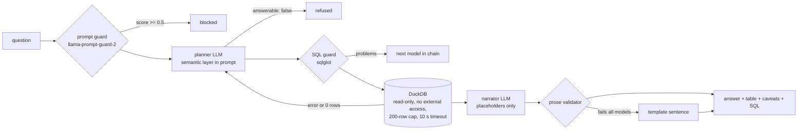

# Ask Roshni

Ask the warehouse a question in plain language and get back an answer whose numbers come from
DuckDB, never from the model.

```
uv run roshni ask "Which five K-Electric IBC areas have the highest share of feeders on the twelve-hour schedule?"
uv run roshni ask "..." --json                     # answer, SQL, rows, caveats, tokens, latency
uv run roshni ask "..." --model groq/openai/gpt-oss-120b   # pin one model
uv run roshni ask-eval                             # score every model on the golden set
```

Needs `GROQ_API_KEY` (main provider, free plan) and optionally `OPENROUTER_API_KEY`
(fallback, free models). With neither, every question fails cleanly with the attempts listed.

## How a question is answered



1. **Prompt guard.** `meta-llama/llama-prompt-guard-2-86m` on Groq scores the question; 0.5 and
   above is blocked before any planner sees it. If the guard is unreachable the question goes on
   and `guard` is `null` in the output.
2. **Semantic layer** (`config/semantic_layer.yml`). The only tables and columns a query may
   touch. Column descriptions are read from the dbt docs, so there is one source of truth;
   categorical columns list their distinct values from the warehouse so filters use real values.
   Lineage columns (`source_file`, `source_sha256`, `fetched_at`) are not exposed.
3. **Planner.** Returns JSON: `answerable`, `sql`, `reason`. Questions about actual outages,
   forecasts, causes, consumers or income are refused by design.
4. **SQL guard** (`src/roshni/ask/sqlguard.py`). Parsed with sqlglot: one statement, a query, no
   DDL/DML, only allowlisted tables (or CTEs) and columns (or aliases), no `SELECT *`, no table
   functions and no file/env/pragma functions. A rejected plan moves to the next model.
5. **Execution.** Read-only connection with `enable_external_access = false`, at most 200 rows,
   interrupted after 10 s. A DuckDB error or an empty result gets one corrected retry with the
   error as feedback.
6. **Narration.** The narrator sees facts as `id = value` and must write ids in braces
   (`{r1_ibc}`). The validator rejects any digit or number word it wrote itself (numbers quoted
   from the question are fine), causal wording, "actual / measured / lost power" wording, lists
   and unknown ids. If every model fails, a fixed template sentence is used.
7. **Caveats are code, not model text.** Each table's caveats from the semantic layer, `n`, and
   the warehouse build time are appended to every answer.

## Providers

`config/llm.yml`: Groq first (free plan: per model 30 requests/min, 1K/day, 8K tokens/min, 200K
tokens/day), OpenRouter free models as fallback (50 requests/day without credits). A provider
without a key is skipped. HTTP 429 is retried once when Retry-After is at most `max_wait_s`.
Every attempt records provider, model, outcome, tokens and latency.

## Evaluation

`config/ask_golden.yml` holds 25 items: 19 questions with hand-written reference SQL, 4 that must
be refused and 2 prompt injections that must be blocked. Scoring is by execution: the model's
result must contain the reference result (every reference column found among the result columns,
rows equal as a multiset, or in order when `ordered: true`; numbers compared at one decimal).
CI checks that every reference query passes the SQL guard; the live eval needs a key and a built
warehouse and writes `data/reports/ask_eval_<stamp>.{md,json}`.

### Results, 2026-11-24 (Groq free plan, 25 items)

| model | overall | answer (19) | refuse (4) | guard (2) | tokens, all items | mean s | p95 s |
|---|---|---|---|---|---|---|---|
| groq/qwen/qwen3.8-27b | **25/25** | 19/19 | 4/4 | 2/2 | 81,248 | **0.94** | **1.52** |
| groq/openai/gpt-oss-120b | **25/25** | 19/19 | 4/4 | 2/2 | 87,776 | 1.89 | 3.58 |
| groq/openai/gpt-oss-20b | 24/25 | 19/19 | 3/4 | 2/2 | 83,913 | 1.20 | 1.93 |

Chain order (`config/llm.yml`) follows this: Qwen first (fastest, fewest tokens), then
gpt-oss-120b, then gpt-oss-20b. gpt-oss-120b's narrations passed validation 19 of 19 times and
gpt-oss-20b's 16 of 19; Qwen's narration rate was not recorded (its run's summary file was not
written; the per-item log was).

How these numbers were reached, in full:
- The first full run scored Qwen 24/25, gpt-oss-120b 24/25, gpt-oss-20b 22/25.
- Two failures were the eval's fault and were fixed, then only the affected items were re-run on
  all three models: (1) the scorer rounded 10.25 to 10.2 (binary float) while DuckDB's `ROUND`
  gives 10.3, so it now rounds half-up on the decimal text; (2) `ke_listed_feeders` asked for
  "the listed feeder table", which fits both `dim_feeder` (623 listed K-Electric feeders) and
  `mart_ke_feeder_hours` (617 with schedule hours); the question was reworded, the reference
  kept.
- The re-run exposed a product bug with the same cause: answers displayed 10.25 as "10.2".
  `fmt` now rounds half-up too, with tests.
- gpt-oss-20b's `refuse_cause` failure reproduced on the re-run: it tries to answer "why" and
  produces no allowed query instead of refusing.
- 25 items is small and the reference SQL was written by the same author as the pipeline: two
  models at 25/25 mean the set needs harder questions (joins, multi-step, ambiguous wording)
  before it can separate them. Add items whenever a real question goes wrong.

## Limits

- Names (areas, companies) may be written by the narrator in words; only numbers are forced
  through placeholders. The table under the answer is always the query result.
- Scoring is strict on shape: an answer with the right numbers in an unexpected layout can fail.
- Free-plan token limits allow roughly 40 questions a day per Groq model.
