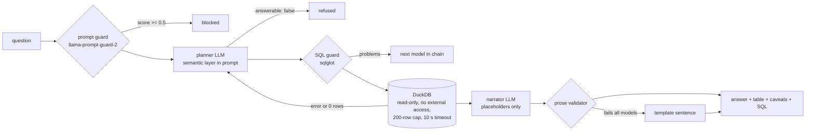
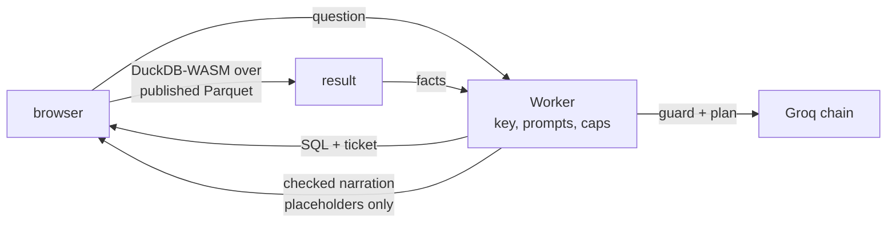

# Ask Roshni

Ask the warehouse a question in plain language and get back an answer whose numbers come from
DuckDB, never from the model.

```
uv run roshni ask "Which five K-Electric IBC areas have the highest share of feeders on the twelve-hour schedule?"
uv run roshni ask "..." --json                     # answer, SQL, rows, caveats, tokens, latency
uv run roshni ask "..." --model groq/openai/gpt-oss-120b   # pin one model
uv run roshni ask-eval                             # score every model on the golden set
```

Needs `GROQ_API_KEY` (main provider, free plan) and optionally `OPENROUTER_API_KEY`
(fallback, free models). With neither, every question fails cleanly with the attempts listed.

## How a question is answered



1. **Prompt guard.** `meta-llama/llama-prompt-guard-2-86m` on Groq scores the question; 0.5 and
   above is blocked before any planner sees it. If the guard is unreachable the question goes on
   and `guard` is `null` in the output.
2. **Semantic layer** (`config/semantic_layer.yml`). The only tables and columns a query may
   touch. Column descriptions are read from the dbt docs, so there is one source of truth;
   categorical columns list their distinct values from the warehouse so filters use real values.
   Lineage columns (`source_file`, `source_sha256`, `fetched_at`) are not exposed.
3. **Planner.** Returns JSON: `answerable`, `sql`, `reason`. Questions about actual outages,
   forecasts, causes, consumers or income are refused by design.
4. **SQL guard** (`src/roshni/ask/sqlguard.py`). Parsed with sqlglot: one statement, a query, no
   DDL/DML, only allowlisted tables (or CTEs) and columns (or aliases), no `SELECT *`, no table
   functions and no file/env/pragma functions. A rejected plan moves to the next model.
5. **Execution.** Read-only connection with `enable_external_access = false`, at most 200 rows,
   interrupted after 10 s. A DuckDB error or an empty result gets one corrected retry with the
   error as feedback.
6. **Narration.** The narrator sees facts as `id = value` and must write ids in braces
   (`{r1_ibc}`). The validator rejects any digit or number word it wrote itself (numbers quoted
   from the question are fine), causal wording, "actual / measured / lost power" wording, lists
   and unknown ids. If every model fails, a fixed template sentence is used.
7. **Caveats are code, not model text.** Each table's caveats from the semantic layer, `n`, and
   the warehouse build time are appended to every answer.

## Providers

`config/llm.yml`: Groq first (free plan: per model 30 requests/min, 1K/day, 8K tokens/min, 200K
tokens/day), OpenRouter free models as fallback (50 requests/day without credits). A provider
without a key is skipped. HTTP 429 is retried once when Retry-After is at most `max_wait_s`.
Every attempt records provider, model, outcome, tokens and latency.

## Evaluation

`config/ask_golden.yml` holds 25 items: 19 questions with hand-written reference SQL, 4 that must
be refused and 2 prompt injections that must be blocked. Scoring is by execution: the model's
result must contain the reference result (every reference column found among the result columns,
rows equal as a multiset, or in order when `ordered: true`; numbers compared at one decimal).
CI checks that every reference query passes the SQL guard; the live eval needs a key and a built
warehouse and writes `data/reports/ask_eval_<stamp>.{md,json}`.

### Results, 2026-11-24 (Groq free plan, 25 items)

| model | overall | answer (19) | refuse (4) | guard (2) | tokens, all items | mean s | p95 s |
|---|---|---|---|---|---|---|---|
| groq/qwen/qwen3.8-27b | **25/25** | 19/19 | 4/4 | 2/2 | 81,248 | **0.94** | **1.52** |
| groq/openai/gpt-oss-120b | **25/25** | 19/19 | 4/4 | 2/2 | 87,776 | 1.89 | 3.58 |
| groq/openai/gpt-oss-20b | 24/25 | 19/19 | 3/4 | 2/2 | 83,913 | 1.20 | 1.93 |

Chain order (`config/llm.yml`) follows this: Qwen first (fastest, fewest tokens), then
gpt-oss-120b, then gpt-oss-20b. gpt-oss-120b's narrations passed validation 19 of 19 times and
gpt-oss-20b's 16 of 19; Qwen's narration rate was not recorded (its run's summary file was not
written; the per-item log was).

How these numbers were reached, in full:
- The first full run scored Qwen 24/25, gpt-oss-120b 24/25, gpt-oss-20b 22/25.
- Two failures were the eval's fault and were fixed, then only the affected items were re-run on
  all three models: (1) the scorer rounded 10.25 to 10.2 (binary float) while DuckDB's `ROUND`
  gives 10.3, so it now rounds half-up on the decimal text; (2) `ke_listed_feeders` asked for
  "the listed feeder table", which fits both `dim_feeder` (623 listed K-Electric feeders) and
  `mart_ke_feeder_hours` (617 with schedule hours); the question was reworded, the reference
  kept.
- The re-run exposed a product bug with the same cause: answers displayed 10.25 as "10.2".
  `fmt` now rounds half-up too, with tests.
- gpt-oss-20b's `refuse_cause` failure reproduced on the re-run: it tries to answer "why" and
  produces no allowed query instead of refusing.
- 25 items is small and the reference SQL was written by the same author as the pipeline: two
  models at 25/25 mean the set needs harder questions (joins, multi-step, ambiguous wording)
  before it can separate them. Add items whenever a real question goes wrong.

## On the website (`/ask/`)

The site is static, so the parts are split. Nothing secret reaches the browser, and no server
runs a query.



- **Export `ask/`** (`roshni export`, `src/roshni/ask/bundle.py`): one Parquet file per
  semantic-layer table with the allowlisted columns only (about 400 KB in all), and
  `context.json`. That file holds the planner and narrator prompts, built from the same code
  `roshni ask` uses, plus the feedback texts, allowlist, caveats and limits.
- **Worker** (`worker/`, TypeScript). `POST /v1/ask` runs the guard and the plan and costs one
  question. `POST /v1/replan` gives one corrected try for that question. `POST /v1/narrate`
  gives one checked narration. `GET /v1/quota` reports what is left. The Worker reads its
  prompts from the site's `context.json` and never takes one from the browser. It checks a
  narration with a port of `check_prose`.
- **Browser** (`web/src/lib/ask/`, page `/[lang]/ask/`). The engine is DuckDB-WASM (DuckDB
  1.5.4). It loads on the first question only and reads the ten tables from `ask/`. It then
  switches off external access and locks the configuration, so a query can read nothing else.
  - `guard.ts` applies the SQL guard's rules to DuckDB's own parse tree
    (`json_serialize_sql`). Only SELECT statements serialize, so DDL, DML, PRAGMA and ATTACH
    fail first.
  - `runner.ts` casts every column to DuckDB's own text, so DECIMAL stays exact, and caps the
    rows.
  - `session.ts` follows `engine.ask`: one corrected try after a guard refusal, an error or an
    empty first result.
  - The engine and the `json` and `parquet` extensions are served by the site
    (`web/scripts/sync-duckdb.mjs`; SHA-256 pinned). Visitors contact only the site and the
    Worker.
  - Without `NEXT_PUBLIC_ASK_URL` the page says Ask Roshni is not switched on, and the nav
    leaves it out.
- **Parity.** `tests/fixtures/ask_parity.json` is generated from the Python answer checks and
  formatting (`uv run python -m roshni.ask.parity`). Python checks the file is current, and
  the Worker's tests (and later the site's) must give the same result for every case.
  `worker/src/llm.json` must equal `config/llm.yml`.
- **Same SQL guard verdicts.** The parity file also holds 48 SQL cases with Python's verdict and
  DuckDB's parse tree; the site's guard must agree on every one. DuckDB-WASM cannot load
  extensions from disk under Node, so the tests use these trees.
- **Same rows on real data** (local only). `uv run python -m roshni.ask.parity --oracle` runs
  every golden reference query on the warehouse and formats it with `engine.fmt`. The site's
  test runs the same queries in DuckDB-WASM on the published Parquet and must get the same
  rows. It found that Parquet stores HUGEINT as DOUBLE: integer sums would have shown as
  "14,895.0", so the bundle now writes them as BIGINT.

### Caps (wrangler.toml)

| cap | value | why |
|---|---|---|
| one visitor, per minute | 3 | stops scripted bursts |
| one visitor, per day | 10 | no one visitor can use up the day |
| whole site, per minute | 6 | Groq allows 8K tokens/min per model; one question is ~3.3K |
| whole site, per day | 150 | ~3.3K tokens each (ask-eval: 81,248 tokens / 25 items) |
| whole site, tokens per day | 450,000 | Groq free plan: 200K/day per model, three models |

- **Days are Pakistan days.** A refused request gets HTTP 429 with the reason and the seconds
  until it may retry.
- **One Durable Object counts everything.** It handles requests one at a time, so counts can't
  race, and an hourly alarm deletes earlier days' counts and expired tickets.
- **Tickets.** A question's re-plan and narration need its ticket. A ticket belongs to the
  visitor who asked, lasts ten minutes and allows one of each, so neither can be repeated or
  shared.
- **Visitor ids.** A visitor is an HMAC of the IP address with a secret (`VISITOR_SALT`) and
  the day. The address is never stored, and the id changes daily.
- **Origins.** Only the site's origins get answers. Other origins get 403. This is not a
  security boundary; the caps are.

### Deploy

The Worker runs at `https://roshni-ask.ahmaduzzammasood.workers.dev` on the owner's free
Cloudflare account. `.github/workflows/worker-deploy.yml` deploys it whenever `worker/` changes
on main, and can also be run by hand. Each run:
1. typechecks and tests the Worker;
2. runs `wrangler deploy`, using the repo secret `CLOUDFLARE_API_TOKEN` (Cloudflare template
   "Edit Cloudflare Workers");
3. copies the repo secret `GROQ_API_KEY` into the Worker, so rotating the key means updating one
   secret and re-running;
4. smoke-tests the live Worker without asking a question: 403 with no origin or another origin,
   and `/v1/quota` ok for the site.

`VISITOR_SALT` is set only in Cloudflare and is kept across deploys. Publish builds the site with
`NEXT_PUBLIC_ASK_URL` set to the Worker's address, which also shows the nav link. The first
deploy (2026-11-26) was made from a laptop; there is no local deploy or local data any more.

Checked live after the first deploy:
- requests with no origin or another origin got 403;
- the CORS preflight answers only `https://azzammasood.github.io`;
- `/v1/quota` showed 10 and 150 questions left;
- `/v1/ask` answered 503, without spending a question, until the site published `ask/`.

Checked on 2026-11-25, before deploy, with the Groq key through a local Worker, on a local
warehouse that held the August K-Electric schedule:
- **Answered correctly.** Most listed feeders: IBC - Orangi - I, 41. Six-hour and twelve-hour
  feeders: 125 and 492 of 617. Most planned shutdown hours, Oct 2026: Islamabad, 2,452.0. All
  three match that warehouse.
- **Refused and blocked.** "actually lost power" was refused, and "ignore all previous
  instructions" was blocked.
- **Capped.** The fourth question in a minute got the per-visitor message.
- **Accessibility.** Axe found 0 violations at 375 px, light and dark, in English and Urdu, with
  and without an answer.

Testing is done on the live site and Worker (owner, 2026-11-26), not on a local warehouse. The
real-data oracle test in `web/src/lib/ask/ask.test.ts` skips without a local export.

Checked on 2026-11-26, live site and Worker: "How many listed K-Electric feeders are scheduled
for six hours a day, and how many for twelve?" returned 110, 462 and 572. That matches the live
data (October schedule). A first comparison with a local warehouse (617) was wrong because that
warehouse still held the August schedule.

## Limits

- Names (areas, companies) may be written by the narrator in words; only numbers are forced
  through placeholders. The table under the answer is always the query result.
- Scoring is strict on shape: an answer with the right numbers in an unexpected layout can fail.
- Free-plan token limits allow roughly 40 questions a day per Groq model.
