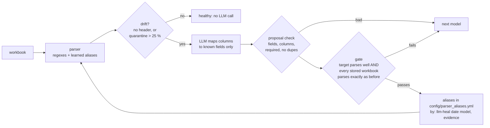

# Self-healing parsers

IESCO publishes a maintenance workbook per circle every month, and the layouts differ: the
parser finds columns by header words ("DATE", "From", "Name of Feeder", ...). When a workbook
arrives with headers the parser has never seen, `roshni heal` repairs the parser — not the data.

```
uv run roshni heal --snapshots store            # detect + heal the newest workbook per item
uv run roshni heal --snapshots store --apply    # ... and write accepted aliases to config
uv run roshni heal-eval --snapshots store       # chaos eval: rename real headers, heal, score
uv run roshni heal-eval --snapshots store --record   # ... and update evals/parser_healing.json
```

The site's `/health/` page shows the last check (`data/heal/status.json`, written by every
`roshni heal`), every learned alias and the committed eval record (export 1.10.0).

## How it works



1. **Detect.** A workbook drifts when no header row is found, or when more than 25 % of its
   rows (and at least 10) are quarantined. Real workbooks quarantine 0–18 % today for genuine
   row problems, which is not drift.
2. **Propose.** The model sees the top twelve rows as cell texts with column numbers and maps
   columns to the parser's fourteen known fields or `ignore`. It never sees or writes a data
   value as output; it only says which column is which.
3. **Check.** Only known fields and existing columns, each field once, the required fields
   (date, start, end, feeder name or code) present. A failing reply moves to the next model.
4. **Learn as aliases.** The proposal becomes exact header texts → field (lower case, single
   spaces). Under a merged "TIME" heading the From/To labels underneath are learned. Texts the
   parser already reads correctly are not added.
5. **Gate, deterministically.** The drifted workbook must now find its header, parse rows,
   quarantine at most 25 % and fewer than before; and every other stored workbook must parse
   exactly as before (row for row, quarantine included). A workbook that contains none of the
   new texts cannot change, so only workbooks containing one are re-parsed.
6. **Apply.** Accepted aliases are appended to `config/parser_aliases.yml` with `by:
   llm-heal <date> <provider/model>` and the evidence. Every row read through an alias carries
   `header_alias_<field>` in `flags`. An owner or Claude can delete or correct an entry.

Why aliases and not a code patch: an alias is data that the existing, tested parser consumes; it
cannot introduce new parsing logic, it applies to every future file with the same header, and the
regression gate can prove it changes nothing else.

## Chaos evaluation

`heal-eval` takes the newest stored workbook of every item, renames the needed headers in a copy
(three scenarios: plain English renames, abbreviations, Urdu), checks that the parser now
drifts, heals it with one pinned model, and counts a case as **recovered** only if the healed
parse equals the original parse row for row (ignoring the alias flags). Learned aliases are not
written anywhere during the eval.

### Results, 2026-11-25 (Groq free plan; 9 real workbooks x 3 scenarios = 27 cases per model)

All 27 mutated copies really broke the parser (no header found) before healing.

| model | recovered exactly | wrong mapping refused | provider busy (HTTP 429) | tokens, 27 cases | mean s |
|---|---|---|---|---|---|
| groq/openai/gpt-oss-20b | **27/27** | 0 | 0 | 49,974 | 0.71 |
| groq/openai/gpt-oss-120b | 26/27 | 1 (used `area` twice) | 0 | 50,570 | 0.95 |
| groq/qwen/qwen3.8-27b | 23/27 | 0 | 4 | 45,349 | 0.65 |

"Recovered exactly" means the healed parse equals the original parse row for row. No case
was healed into different data: every proposal was either exact or refused by the checks.
Qwen recovered every case it got an answer for; its 4 failures were Groq capacity errors
(HTTP 429 without Retry-After, still busy after a 5 s retry). In production the chain falls
through to the next model; the eval pins one model, so they count as failures here.

How these numbers were reached, in full:
- A first run (2026-11-25) failed every Islamabad case for all three models: the proposals also
  mapped columns the parser has never read (e.g. "S. No" to serial), which would change the
  other stored Islamabad version, so the gate refused the whole proposal. The gate now drops
  such optional aliases one by one and re-gates the rest; a required field that regresses
  still fails. The same run was cut short by a DNS outage on this machine, which crashed the
  process; the chain now records a network error as a failed attempt and moves on.
- The live smoke test before that found two healer bugs: under one merged heading with data
  directly beneath, the first data value ("09:00") would have been learned as a header, and
  the parser paired start/end under a merged heading only for the words TIME/TIMING. Both
  fixed, with tests.
- The numbers above are the second full run (gpt-oss models) and a third run for Qwen after
  the 429 retry change; the earlier runs are not mixed in.
- Ask Roshni's model order (Qwen first) is unchanged; for healing the gate makes the order a
  matter of speed, not safety.

## Limits

- Only header drift is healed. A new date or time format, or a different file type, still ends
  in quarantine with a reason and a notice; that needs a code change and a test.
- One workbook family (IESCO maintenance). The same pattern fits the IESCO scenario workbooks.
- Parsing one large workbook takes about 6 s (openpyxl), so a heal of one drifted file takes
  roughly half a minute; healthy files cost one parse and no LLM call.
